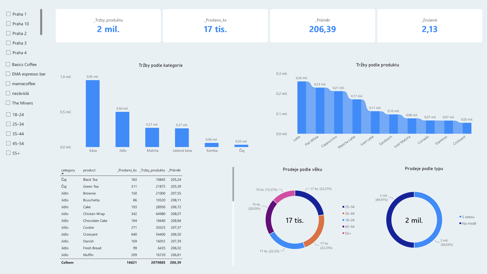
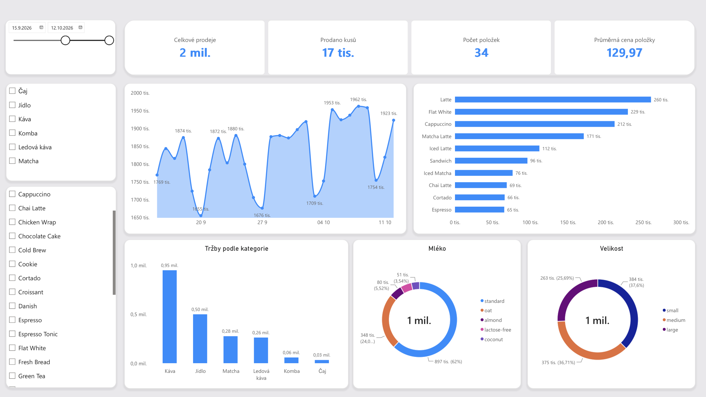

# CUPS — Coffee ordering app: Data analytics case study

> End-to-end analytics project on a demo dataset from a mobile coffee ordering app I'm building. From database design to SQL analysis to Power BI dashboards.

## Context

I'm developing **CUPS** — a mobile app where customers can pick the nearest cafe, place a pre-order with customizations (milk, size, syrup), choose a pickup time, and grab their drink without waiting. The app updates order status in real-time.

To validate the business model and practice analytics, I generated a realistic demo database simulating **60 days of operations** across Prague cafes.

## Dataset

| | |
|---|---|
| **Period** | Aug 14 – Oct 12, 2026 (60 days) |
| **Cafes** | 108 real Prague locations (independent + chains) |
| **Customers** | 1,000 (700 returning, 300 one-time) |
| **Orders** | 10,043 (214 cancelled, 9,829 completed) |
| **Order items** | 15,926 line items |
| **Products** | 35 items across 6 categories |
| **Revenue** | ~2,027,000 Kc, avg check 206 Kc |

<details>
<summary>ER diagram</summary>

```
cafes ──────────┐
  cafe_id (PK)  │
  name          │
  chain         │
  district      ├──< orders >──┬── customers
  lat, lng      │    order_id  │    customer_id (PK)
  prep_minutes  │    cafe_id   │    persona
                │    status    │    segment
                │    total     │    home_cafe_id ──> cafes
                │    ...       │
                │              │
                ├──< order_items    products
                     item_id        product_id (PK)
                     order_id ──>   category
                     product_id >── base_price
                     qty, price
                     milk, size
                     syrup, sugar

promo_codes
  code (PK)
  percent
```

</details>

### Data files

| File | Format | Use |
|---|---|---|
| `cups_demo_postgres.sql` | PostgreSQL dump | Full DB: tables + data |
| `cups_demo.sqlite` | SQLite | Portable, no server needed |
| `cups_demo.xlsx` | Excel | Direct import to Power BI |
| `*.csv` | CSV | Universal import |

## SQL analysis

Five query sets covering the key areas of business analytics:

| # | File | Topic | Key skills |
|---|---|---|---|
| 01 | [Basic exploration](sql/01_basic_exploration.sql) | Revenue, top products, peak hours | `GROUP BY`, aggregates, `FILTER` |
| 02 | [Customer analysis](sql/02_customer_analysis.sql) | Segments, personas, LTV | `JOIN`, subqueries, `CASE` |
| 03 | [Product analysis](sql/03_product_analysis.sql) | Revenue by product, categories, upsell | CTEs, percentage calculations |
| 04 | [Time & trends](sql/04_time_and_trends.sql) | Weekly dynamics, growth rate | `DATE_TRUNC`, `LAG`, WoW % |
| 05 | [Operations](sql/05_operations.sql) | Prep time, cancellations, promos | `HAVING`, `COALESCE`, `FILTER` |

### Sample query: Weekly revenue growth

```sql
WITH weekly AS (
    SELECT
        DATE_TRUNC('week', date)::DATE AS week,
        SUM(total)                     AS revenue
    FROM orders
    WHERE status = 'picked_up'
    GROUP BY DATE_TRUNC('week', date)
)
SELECT
    week,
    revenue,
    LAG(revenue) OVER (ORDER BY week) AS prev_week,
    CASE
        WHEN LAG(revenue) OVER (ORDER BY week) > 0
        THEN ROUND(100.0 * (revenue - LAG(revenue) OVER (ORDER BY week))
             / LAG(revenue) OVER (ORDER BY week), 1)
    END AS wow_growth_pct
FROM weekly
ORDER BY week;
```

## Power BI dashboards

<!-- TODO: Replace with your actual screenshots -->

### 1. Executive overview


Key DAX measures:
```dax
Total Revenue = SUM(orders[total])
Avg Check = AVERAGE(orders[total])
Cancellation Rate = 
    DIVIDE(
        CALCULATE(COUNTROWS(orders), orders[status] = "cancelled"),
        COUNTROWS(orders)
    )
```

### 2. Product performance


## Key findings

| Insight | Detail | Business action |
|---|---|---|
| **70% are returning customers** | Averaging ~14 orders each over 60 days | Loyalty program could amplify this |
| **Peak at 8–10 AM** | 40%+ of orders in a 2-hour window | Staffing and prep optimization needed |
| **Avg prep time varies 2x between cafes** | 4–10 min range | Standardize workflows at slow locations |
| **Promo PRVNI drives first orders** | 84 uses, first-order-only | Keep as acquisition tool |
| **Cancellation rate ~2.1%** | Mostly customer-initiated | Acceptable, monitor per-cafe outliers |
| **Top 5 products = ~60% of revenue** | Cappuccino, Latte, Flat White dominate | Focus supply chain on core SKUs |

## Tech stack

- **Database**: PostgreSQL 16 / SQLite
- **SQL**: JOINs, CTEs, aggregations, `LAG`, date functions
- **Visualization**: Power BI Desktop + DAX
- **Version control**: Git + GitHub

## How to run

```bash
# PostgreSQL
createdb cups
psql -d cups -f data/cups_demo_postgres.sql

# Or use SQLite (no install needed on Mac)
sqlite3 data/cups_demo.sqlite < sql/01_basic_exploration.sql
```

For Power BI: open `dashboards/cups_dashboard.pbix` or import `data/cups_demo.xlsx`.

## About

This project is part of my portfolio demonstrating data analytics skills applied to a real product I'm building. The dataset is synthetic but modeled on real Prague cafe locations and realistic ordering patterns.

---

*Built with PostgreSQL, Power BI, and a lot of coffee.*
